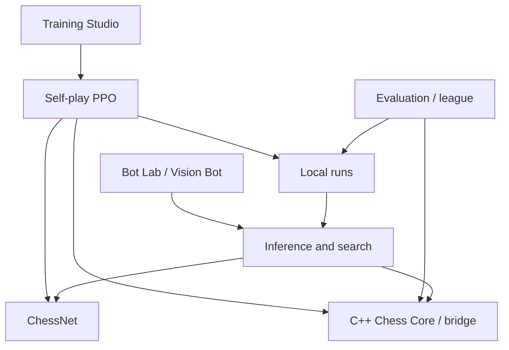

# Архитектура Chess AI

## Границы компонентов

| Слой | Файлы и ответственность |
| --- | --- |
| Правила | src/chess.* — позиция и легальные ходы; src/search.* — встроенный поиск; src/main.cpp — CLI/UCI/bridge |
| Модель | neural/encoding.py, model.py, checkpoint.py — входы, policy/value, проверка совместимости |
| Обучение | neural/train.py, selfplay.py, league.py, quality.py — supervised и PPO, замороженные соперники и контроль качества |
| Оценка | neural/evaluation.py, tournament.py, model_guard.py — сравнения и отбор best |
| Инференс | neural/agent.py, search.py, intelligence.py — выбор легального хода и поиск |
| Специализации | neural/skill_boost*.py, agent_profiles.py, agent_specialization.py, phantom_opening.py, phantom_trainer.py |
| Хранилище | neural/storage.py и tools/ — локальные журналы, миграции, контроль checkpoint |
| UI | dashboard/server.py и dashboard/ui/ — управление процессами, просмотр метрик; botlab/ и visionbot/ — отдельные игровые интерфейсы |

C++ — единственный источник легальности. Обучение получает партии из собственного симулятора, а интерфейсы игры не являются скрытым источником тренировочных данных.

## Контракт совместимости

- `planes19_actions73_v1`: 19×8×8 входных признаков, 4672 policy logits, один value.
- Размер сети восстанавливается из метаданных checkpoint. Историческая базовая конфигурация — 32 канала и 2 residual-блока.
- Полный PPO checkpoint содержит модель, optimizer, config, feature_version и iteration. Специализированные веса не заменяют его автоматически.
- `runs/<ID>/checkpoints/latest.pt` — resume, `best.pt` — отбор, `iteration_*.pt` — история.
- JSONL и gzip-архивы сохраняют опыт и партии. Метрики не заменяют checkpoint.

## Инварианты разработки

Не менять кодировщик, протокол bridge или схему сохранений без явной версии и миграции. Сохранять существующие имена Python-пакетов и CLI, пока не подготовлены совместимые переходы. Проверять легальность, восстановление optimizer, архивы и независимые матчи. Не выставлять локальный API без авторизации в сеть.

Детали: [PPO](SELFPLAY_METHOD.md), [Training Studio](TRAINING_STUDIO.md), [локальные данные](LOCAL_UPDATE.md).
